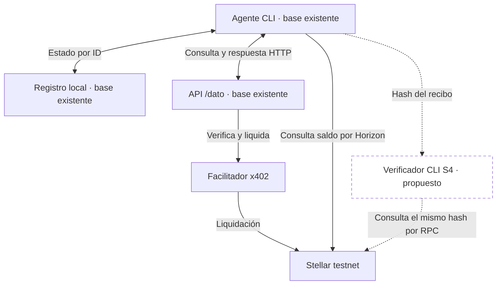
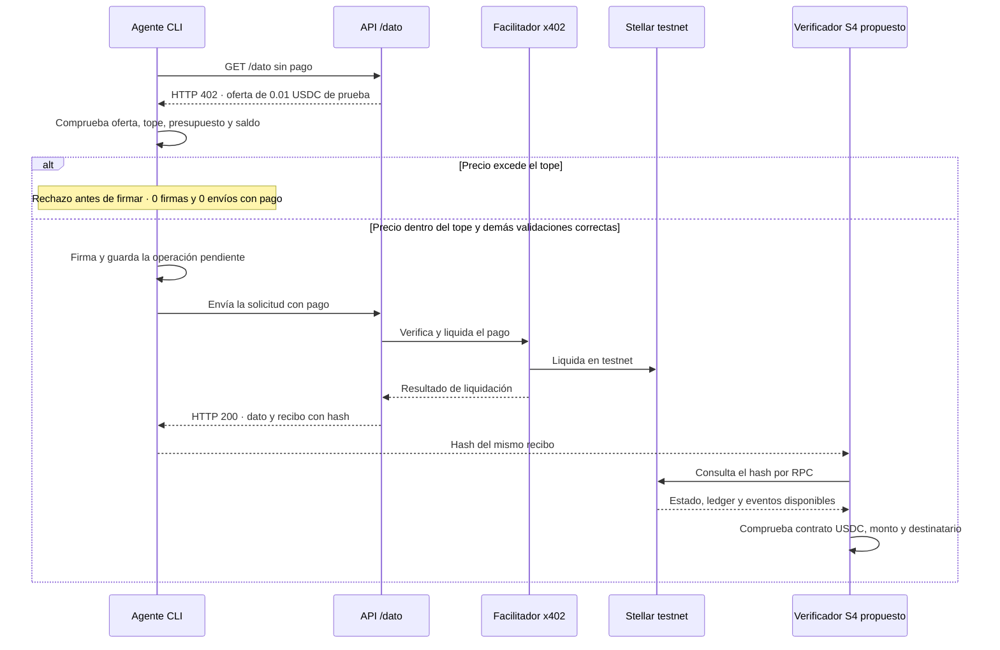

# Diagrama de arquitectura de Rizo

[Arquitectura, decisiones y estado](arquitectura.md)

## Componentes

El agente, la API y el registro local existen en la base curricular. El verificador S4, con borde discontinuo, está propuesto para Rizo. Stellar testnet y sus servicios son dependencias externas.

## Secuencia prevista de la demo

El pago nuevo y la evidencia de S4 siguen pendientes. Los montos ilustran los criterios de aceptación del plan.

Si el envío queda incierto, el agente conserva el pendiente en el registro local y bloquea nuevos pagos hasta revisar el caso.
